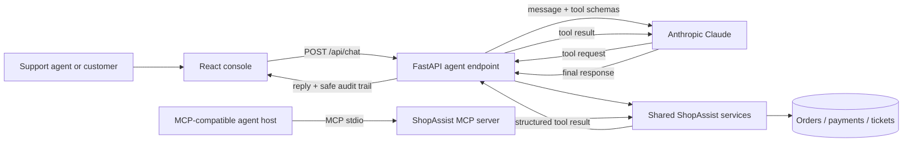
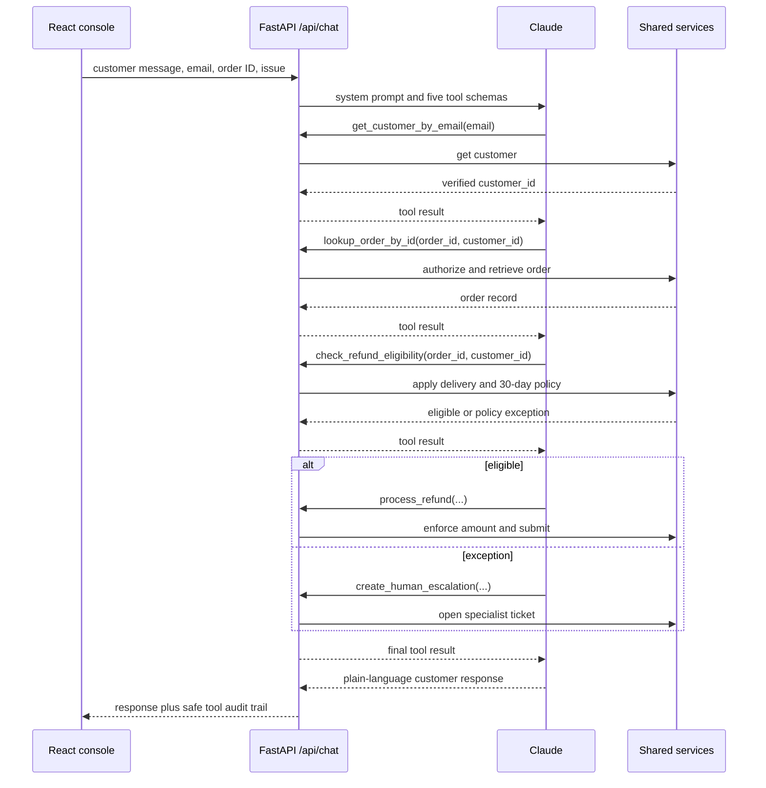

# ShopAssist architecture

ShopAssist separates conversation from authority. Claude can decide which question to ask next
and write the customer-facing response, but it cannot read an order, determine eligibility, or
issue a refund by itself. Those decisions live in the shared backend service layer.



## Request workflow

For a typical damaged-item request, the live-LLM path is:



The LLM tool loop is implemented in [`backend/app/agent.py`](backend/app/agent.py).
The tools do not trust values such as `delivered_days_ago` supplied by the model; they fetch the
authoritative order record and then enforce authorization and policy in
[`backend/app/services.py`](backend/app/services.py).

## Components and responsibilities

| Component | Responsibility | Does not do |
| --- | --- | --- |
| React console | Collects the case brief and renders Claude's reply/audit trail | Call Claude or MCP directly; hold API keys |
| FastAPI `/api/chat` | Runs the Anthropic tool-use loop and returns a safe response | Decide policy or write directly to a payment system |
| Shared services | Verify ownership, retrieve orders, enforce policy, submit actions | Generate conversational language |
| MCP server | Exposes the same five shared service operations over MCP stdio | Maintain a separate copy of business rules |
| Claude | Selects tools, asks for missing details, drafts replies | Override authorization, policy, or refund limits |

## Running the LLM workflow

Create a `.env` file at the repository root (or export the variables in the process that runs
FastAPI):

```dotenv
ANTHROPIC_API_KEY=your_key_here
# Optional. Defaults to claude-sonnet-4-6.
ANTHROPIC_MODEL=claude-sonnet-4-6
```

Then install and run the backend:

```bash
cd backend
python3 -m venv .venv
source .venv/bin/activate
pip install -r requirements.txt
uvicorn app.main:app --reload
```

The React app sends its case brief to `POST /api/chat`. If the API key or LLM dependency is
missing, this endpoint returns `503` with an actionable configuration message; the existing
`POST /api/cases/resolve` endpoint remains available for deterministic, no-key demos.

## Running the MCP server

From `shopassist-app/backend`, use:

```bash
python -m app.mcp_server
```

It is a stdio MCP server, so an MCP client launches it rather than opening it in a browser. A
client configuration should use its virtualenv Python executable, set the working directory to
`shopassist-app/backend`, and run `-m app.mcp_server`. The repository-root
[`shopassist_mcp_server.py`](../shopassist_mcp_server.py) remains a compatibility launcher.

The MCP tools are `get_customer_by_email`, `lookup_order_by_id`,
`check_refund_eligibility`, `process_refund`, and `create_human_escalation`.

## Production notes

- Replace the in-memory fixture dictionaries with authenticated order, payment, and ticketing
  adapters. Make refund submission idempotent and persist audit events.
- Authenticate the web user before accepting customer details, authorize staff roles for action
  tools, and protect PII in logs and model requests.
- Keep API keys on the backend only. The browser receives only the final response and a
  deliberately safe, developer-message-free audit trail.
- Add rate limits, timeouts, monitoring, approval thresholds, and human review for high-value
  actions before handling real transactions.
